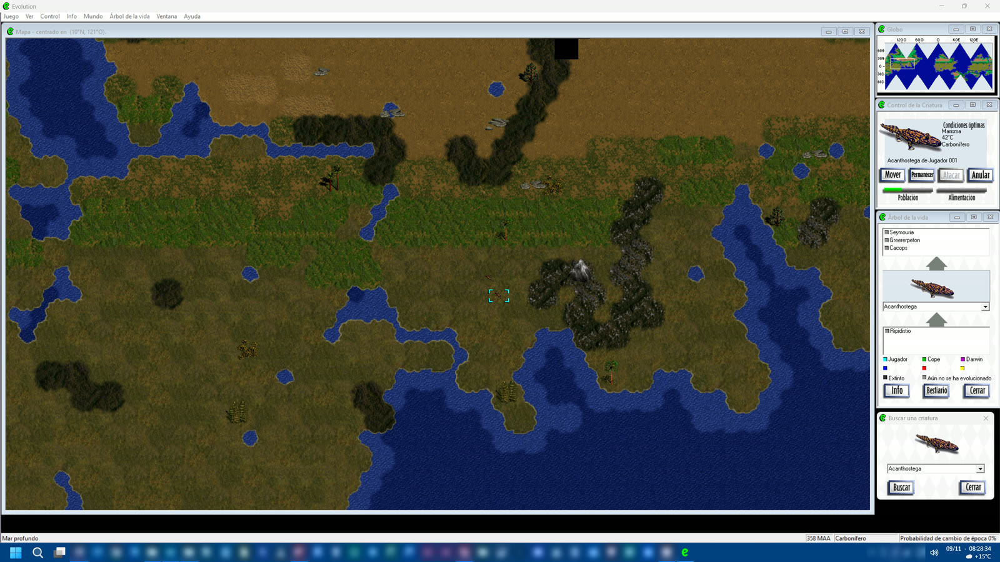

# Evolution: El Juego de la Vida Inteligente - Fix Windows 11

Arreglo no oficial para jugar a **Evolution: El juego de la vida inteligente** (Discovery Multimedia / Crossover Technologies, 1997), **edición española en CD**, en Windows 10 y 11.

> *English summary at the end.*

Este repositorio **no contiene el juego**: necesitas tu propio CD (o una imagen suya). El instalador lo copia y le aplica el arreglo.



## Qué consigues

- **Funciona en Windows 10 y 11:** sin el instalador original (que exige Windows 95), sin permisos de administrador y sin modos de compatibilidad.
- **Sin cuelgues ni cierres conocidos:**
  - gestor de memoria nuevo, porque el original (SmartHeap) se colgaba;
  - corregido el bloqueo que congelaba el juego después de algunos desastres.
- **Juegas sin el CD.**
- **Vídeos:**
  - se ven (antes salían en negro) en una ventana 4:3;
  - no cambian la resolución ni los colores de la pantalla;
  - opcional: los 13 vídeos remasterizados a 1280x960.
- **Música en calidad de CD** (opcional, desde una imagen BIN/CUE).
- **Nuevos controles con el ratón:**
  - rueda sobre el mapa: zoom (100, 75 y 50 %);
  - botón central: Lista de criaturas;
  - botón lateral de arriba: Árbol de la vida;
  - botón lateral de abajo: Buscar.
- **La ayuda vuelve a funcionar:** se convierte a una página web que se abre en el navegador.
- **Carpeta portátil:** puedes moverla a otro disco o a otro PC sin reinstalar.

## Requisitos

- **Windows 10 u 11.**
- **El juego:** el CD de la **edición española** de *Evolution: El juego de la vida inteligente* (versión 1.2), o una imagen suya (`.cue`/`.bin` o `.iso`). Otras ediciones no son compatibles: el instalador lo comprueba y no toca nada si no es la española.
- **Espacio:** unos 600 MB para el juego.
- **Opcional, para la música en calidad de CD:** una imagen **BIN/CUE** del CD. Las imágenes `.iso` y las copias de archivos no incluyen las pistas de audio. Sin ella se usa la música original del juego, más comprimida.
- **Opcional, para los vídeos HD:**
  - una tarjeta gráfica compatible con **Vulkan** (casi cualquiera desde 2016);
  - conexión a internet la primera vez, para descargar FFmpeg y Real-ESRGAN (unos 150 MB);
  - unos 480 MB más para los vídeos y unos 2 GB libres mientras se generan;
  - tiempo: entre unos 10 minutos y un par de horas, según la tarjeta gráfica.
- **Opcional:** un ratón con rueda y botones laterales, para los atajos nuevos.

## Instalación

1. Descarga este repositorio: botón **Code** → **Download ZIP**, y descomprímelo.
2. Ten a mano el juego: el CD metido, una imagen montada o el archivo `.cue` de tu imagen.
3. En la carpeta descomprimida, haz clic derecho en un hueco → **Abrir en Terminal**, y ejecuta:

   ```powershell
   powershell -ExecutionPolicy Bypass -File .\instalar.ps1
   ```

   Te preguntará de dónde copiar el juego (por ejemplo `D:` o `C:\Imagenes\Evolution.cue`) y dónde instalarlo (por defecto, `C:\Juegos\Evolution`). También puedes indicarlo directamente:

   ```powershell
   powershell -ExecutionPolicy Bypass -File .\instalar.ps1 -Origen "C:\Imagenes\Evolution.cue" -Destino "D:\Juegos\Evolution"
   ```

4. Abre el juego con el acceso directo **Evolution** del escritorio.

El instalador:
- copia el juego;
- comprueba que es la edición española 1.2;
- parchea el ejecutable (guarda el original como `EVOLUTION.EXE.orig`);
- instala la DLL del arreglo (guarda la original como `SH33W32.DLL.orig`);
- convierte la ayuda;
- si le das una imagen `.cue`, pone la música en calidad de CD.

### Vídeos HD (opcional)

Con el juego ya instalado:

```powershell
powershell -ExecutionPolicy Bypass -File .\videos-hd.ps1 -Juego "C:\Juegos\Evolution"
```

- **Qué hace:** descarga FFmpeg y Real-ESRGAN de sus páginas oficiales y remasteriza los 13 vídeos del juego con tu tarjeta gráfica. Los guarda en `MOVIES\HD`, con su sonido original.
- **Si lo interrumpes:** al volver a lanzarlo, sigue por donde iba.
- **Si ya tienes las herramientas:** indícalas con `-FFmpeg` y `-RealEsrgan`.
- **Para volver a los vídeos originales:** borra la carpeta `MOVIES\HD`.

El tratamiento es suave: quita el tramado y las bandas de los 256 colores originales y amplía la imagen 4 veces, sin inventar detalles. Los vídeos de 1997 eran de 320x240, así que en escenas con mucho movimiento siguen notándose restos de la compresión original.

## Preguntas frecuentes

- **Windows pide instalar "DirectPlay".** El juego lo usa para el multijugador. Acepta y Windows lo instala solo.
- **Se ve algo borroso.** Si tu Windows usa una escala distinta del 100 % (por ejemplo, 125 %), Windows amplía el juego y lo suaviza. Es normal: el juego se diseñó para 100 %. Si quieres probar a mejorarlo: Propiedades de `EVOLUTION.EXE` → Compatibilidad → Cambiar configuración de PPP alta → Invalidar el comportamiento de escalado → **Sistema (mejorado)**.
- **¿Puedo mover la carpeta del juego?** Sí, a cualquier disco o PC. El acceso directo del escritorio habrá que volver a crearlo.
- **Desinstalar.** Borra la carpeta del juego y el acceso directo. La configuración está en el registro, en `HKEY_CURRENT_USER\Software\Discovery Multimedia\Evolution`, y se puede borrar también.
- **Volver al juego original.** Renombra `EVOLUTION.EXE.orig` y `SH33W32.DLL.orig` quitándoles el `.orig`. No funcionará en Windows actuales.
- **Algo falla.** Crea un archivo vacío llamado `evo-trace.on` en la carpeta del juego, reproduce el problema y abre una incidencia con el `evo-trace.log` que se genera.

## Cómo funciona

El arreglo es una DLL que sustituye a la librería de memoria del juego (`SH33W32.DLL`) y corrige el resto en memoria, más un parche de 2 bytes en el ejecutable. Los detalles están en [docs/TECNICO.md](docs/TECNICO.md).

| Carpeta | Contenido |
|---|---|
| `instalar.ps1` | Instalador |
| `videos-hd.ps1` | Remasterización opcional de los vídeos |
| `bin/SH33W32.DLL` | La DLL del arreglo, compilada |
| `dll/` | Su código fuente (C) y `compilar.bat` (requiere Visual Studio con C++) |
| `herramientas/Herramientas.cs` | Lectura de imágenes de CD, extracción de audio y conversor de la ayuda |
| `docs/` | Documentación técnica |

## Aviso legal

- Este proyecto no está relacionado con Discovery Communications ni con Crossover Technologies, ni cuenta con su respaldo. *Evolution* y sus contenidos son propiedad de sus titulares.
- Este repositorio solo contiene código propio y no distribuye ningún archivo del juego. Para usarlo necesitas una copia legal del juego.

## Créditos

- **[FFmpeg](https://ffmpeg.org/)** y **[Real-ESRGAN](https://github.com/xinntao/Real-ESRGAN)** (Xintao Wang et al.): se usan para los vídeos HD. Se descargan de sus sitios oficiales; no se incluyen aquí.
- **Formato WinHelp:** documentación de Manfred Winterhoff (helpdeco).

## Licencia

[MIT](LICENSE) para el código de este repositorio.

---

## English summary

- **What it is:** an unofficial fix for the **Spanish CD edition (v1.2)** of *Evolution: The Game of Intelligent Life* (1997) on Windows 10/11. The game itself is **not included**: you need your own CD or disc image.
- **What it fixes:**
  - no installer or admin rights needed;
  - SmartHeap hang replaced by a new memory manager;
  - black movies and display-mode switching;
  - CD check;
  - a deadlock after disasters.
- **Optional extras:**
  - CD-quality music (from a BIN/CUE image);
  - remastered 1280x960 movies (FFmpeg + Real-ESRGAN, generated locally);
  - map zoom with the mouse wheel and extra mouse buttons;
  - the WinHelp manual converted to HTML.
- **How to install:** `powershell -ExecutionPolicy Bypass -File .\instalar.ps1`. The installer only accepts the Spanish 1.2 executable (SHA-256 checked).
